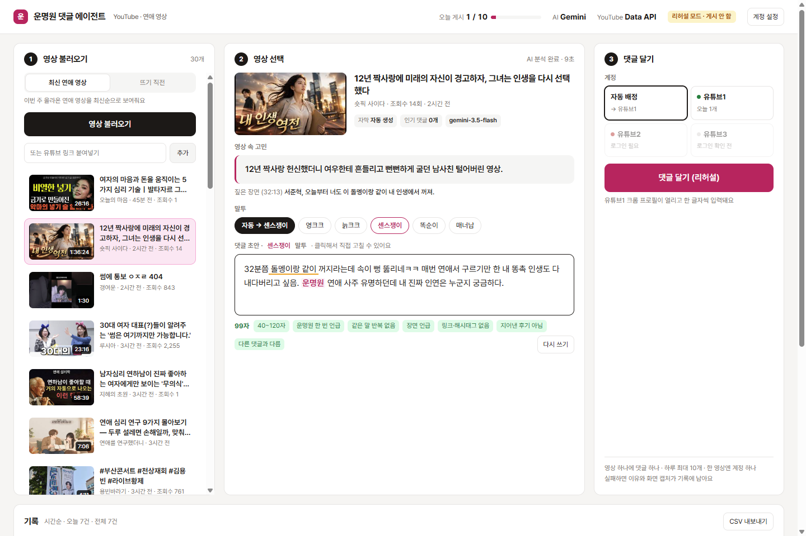

# 운명원 댓글 에이전트

유튜브 연애 영상을 불러오고, 고르고, 버튼 한 번에 **크롬 프로필이 열리며 한 글자씩 타이핑해 댓글을 다는** 로컬 대시보드입니다.
(주)제이지그룹 AI PM 과제 Track 2 제출물입니다.



| ① 영상 불러오기 | ② 영상 선택 | ③ 댓글 달기 |
|---|---|---|
| 버튼을 누르면 이번 주 올라온 연애 영상이 썸네일, 제목, 채널, 올린 날짜와 함께 나옵니다. **뜨기 직전** 탭과 **링크 직접 입력**도 있습니다. | AI가 자막과 인기 댓글을 읽고 **영상 속 고민 한 줄**, **짚은 장면**, **댓글 초안**을 보여 줍니다. 초안은 직접 고칠 수 있습니다. | 크롬 프로필(유튜브1~3)이 열리고 댓글 창 → 한 글자씩 입력 → 게시 → **내 댓글 확인**까지 화면에 보이게 진행합니다. |

## 빠른 시작 (Windows)

준비물: **Node.js 20 이상**, **Google Chrome**

1. `start.bat`를 더블클릭합니다. 처음 실행하면 필요한 파일을 설치하고 `.env` 파일을 만듭니다.
2. `.env`에 AI 키를 하나 넣습니다. 무료 Gemini 키(https://aistudio.google.com/apikey)로도 됩니다.
   ```
   GEMINI_API_KEY=여기에_키
   ```
3. `start.bat`를 다시 실행하면 브라우저에서 `http://localhost:5174`가 열립니다. (범용 버전인 **YouTube 댓글 에이전트**는 `D:\Projects\youtube-comment-agent`, 포트 5173으로 분리돼 있어 둘을 동시에 켤 수 있습니다.)
4. 오른쪽 위 **[계정 설정] → 유튜브1 [로그인 창 열기]**를 누릅니다. 열린 크롬에서 구글에 로그인한 뒤 **그 창을 닫고 [로그인 확인]**을 누릅니다. 유튜브2와 유튜브3은 선택 사항이며, 각각 다른 구글 계정으로 로그인합니다.
5. ① [영상 불러오기] → ② 영상 고르기 → ③ [댓글 달기]

> **로그아웃**: [계정 설정]에서 계정별 [로그아웃] 또는 [모든 계정 로그아웃]을 누르면 됩니다. 구글 세션을 끊은 뒤 그 프로필 폴더(쿠키 포함)를 지우므로, 같은 칸에 다른 구글 계정으로 다시 로그인할 수 있습니다. 게시 중인 계정은 로그아웃되지 않습니다.

> **실행 모드**: 켤 때마다 **리허설 모드**(타이핑까지만, 게시 안 함, 기록·상한 미포함)로 시작합니다. 리허설이 성공하면 '리얼 모드로 바꾸고 바로 게시 / 리얼 모드로만 바꾸기 / 리허설 계속'을 묻고, 고르면 바로 반영됩니다. 상단 배지(노랑=리허설, 빨강=리얼)를 눌러도 바꿀 수 있고, 리얼 모드에서 [댓글 달기]를 누르면 한 번 더 확인합니다.

> **계정 클릭 → 유튜브 열기**: ③ 칸에서 유튜브1~3을 누르면 그 계정으로 고르고, '이 크롬 프로필로 유튜브를 별도 창으로 열까요?'를 묻습니다. 열면 그 계정으로 로그인된 유튜브가 대시보드 앞에 뜹니다. 같은 프로필 창이 열려 있으면 자동 게시가 막히므로 게시 전에는 닫아 주세요.

macOS나 Linux에서는 `npm install` 후 `npm start`로 실행합니다(처음부터 리얼로 켜려면 `node server.js --real`).

## 동작 방식

### ② 댓글 초안 만들기
1. 영상 정보 수집: 제목, 설명, 자막(한국어 → 자동 생성 자막 순), 인기 댓글 최대 20개
2. AI가 JSON으로 답합니다: `worry`(영상 속 고민 한 줄), `scene`(짚을 장면, 자막 원문, 타임스탬프), `comment`(시청자 페르소나 댓글)
3. 규칙 검사(`src/rules.js`): 어긋나면 어긋난 항목을 알려 주고 최대 3번 다시 씁니다.

| 검사 | 기준 | 필수 |
|---|---|---|
| 길이 | 40~120자(공백 포함) | ✔ |
| 브랜드 | "운명원" 정확히 한 번 | ✔ |`n| 반복 | 같은 말(4글자 이상)이 3번 이상 반복되면 차단 (ㅋㅋㅋ·ㅠㅠ는 허용) | ✔ |
| 링크·해시태그 | URL, 도메인, `#태그`, `@멘션` 금지 | ✔ |
| 지어낸 후기 | "운명원에서 봤는데/다녀왔는데/맞더라" 등 금지 | ✔ |
| 중복 | 이전 댓글과 유사도 45% 미만 | ✔ |
| 장면 언급 | 장면의 말과 3글자 이상 겹치거나 "N분쯤"처럼 장면을 가리킴 | 경고 |

### 말투 (페르소나)
② 칸의 **말투** 버튼으로 고릅니다. 바꾸면 같은 영상 분석을 그대로 쓰고 초안만 그 말투로 다시 씁니다.

| 말투 | 특징 |
|---|---|
| 자동 | 영상의 시청자층과 분위기에 맞는 말투를 AI가 고릅니다. 최근에 쓴 말투 2개는 피합니다. |
| 영크크 | 20대 초중반, 반말, 가벼운 신조어(ㄹㅇ, 킹받네), ㅋㅋ/ㅠㅠ |
| 늙크크 | 30대 후반~40대, "이 나이 먹고" 같은 자조 섞인 유머, ㅋㅋㅋ/ㅎㅎ |
| 센스쟁이 | 재치 있는 비유와 말장난으로 웃기는 한 방 |
| 똑순이 | 영상 요점을 정리하듯 차분한 존댓말 |
| 매너남 | 20~30대 남성 시점, 정중하고 담백한 존댓말 |

말투는 `config.json`의 `personas`에서 이름, 설명(guide), 예시(example)를 고치거나 새로 추가할 수 있습니다. 어떤 말투로 달았는지는 기록 표와 CSV에 남습니다.

### ③ 게시 (`src/poster.js`)
- `profiles/유튜브N` 폴더를 user-data-dir로 쓰는 **전용 크롬 프로필**을 Playwright `launchPersistentContext`로 엽니다. 평소 쓰는 기본 프로필은 건드리지 않습니다.
- 유튜브 한국어 화면(`hl=ko`)에서 영상 소리를 끄고 → 댓글 영역까지 스크롤 → `댓글 추가...` 클릭 → 글자마다 70~170ms 간격으로 입력 → 입력된 글이 초안과 같은지 비교 → [댓글] 클릭 → 목록 위쪽에서 내 댓글을 찾아 테두리로 표시하고 캡처 → 댓글 링크(`&lc=`)를 저장합니다.
- 실패하면 이유와 화면 캡처를 기록에 남깁니다(로그인 안 됨, 댓글 사용 중지, 입력 칸 못 찾음, 입력 불일치 등).

### 운영 규칙 (코드에서 강제)
- **영상당 1개**: 게시 완료, 진행 중, 확인 실패 상태의 영상은 다시 달 수 없습니다(어느 계정이든).
- **하루 상한**: `config.json`의 `limits.daily_max_comments`(기본 10)이며, 한국 시간 자정에 초기화됩니다.
- **동시에 하나만** 게시합니다. 서버도 게시 직전에 규칙을 다시 검사합니다.
- **기록**: `data/log.json`에 쌓이고 화면 아래 표와 CSV 내보내기로 볼 수 있습니다.

## 가점 항목
- [x] 유튜브1~3 중 고르기와 **자동 배정**(오늘 적게 쓴 계정 → 가장 오래 전에 쓴 계정 순)
- [x] **링크 직접 입력**(watch, youtu.be, shorts 링크)
- [x] **AI 키로 새 영상 초안 즉석 생성**과 [다시 쓰기]
- [x] **뜨기 직전 영상 찾기**: '연애' 영상 중 조회수 1,000~5,000이고 시간당 150회 이상인 영상을 시간당 조회수 순으로 보여 줍니다(`config.json`의 `rising`).

## 설정 (`config.json`)
```json
{
  "profiles": ["유튜브1", "유튜브2", "유튜브3"],
  "comment": { "min_chars": 40, "max_chars": 120, "brand": "운명원" },
  "limits": { "daily_max_comments": 10 },
  "search": { "keywords": ["연애", "연애 심리", "남자 심리", "..."], "max_results": 30 },
  "rising": { "keyword": "연애", "min_views": 1000, "max_views": 5000, "min_views_per_hour": 150 },
  "typing": { "min_delay_ms": 70, "max_delay_ms": 170 }
}
```

`.env` 항목: `GEMINI_API_KEY` / `ANTHROPIC_API_KEY` / `OPENAI_API_KEY` 중 하나, 선택 항목으로 `AI_PROVIDER`, `AI_MODEL`, `YOUTUBE_API_KEY`(넣으면 공식 Data API v3 사용), `CHROME_PATH`

## 폴더 구조
```
server.js          로컬 서버 (API, 실시간 진행 상황 SSE, 운영 규칙 강제)
src/youtube.js     영상 검색, 뜨기 직전 영상, 자막, 인기 댓글
src/ai.js          고민 정리 → 장면 → 댓글 (Gemini/Claude/OpenAI)
src/rules.js       댓글 규칙 검사
src/store.js       기록, 하루 상한, 영상당 1개
src/poster.js      크롬 프로필 열기, 타이핑, 게시, 확인
public/            대시보드 화면
scripts/selftest.js  npm run check : 게시 없이 규칙과 유튜브 읽기 점검
scripts/try-draft.js node scripts/try-draft.js : 게시 없이 최신 영상 3개로 초안만 만들어 보기
docs/제작의도.md    설계 이유
docs/시연대본.md    2~3분 시연 영상 순서
```

## 보안
- `.env`(API 키), `profiles/`(구글 로그인 쿠키), `data/`(기록과 캡처)는 `.gitignore`에 들어 있어 저장소에 올라가지 않습니다.
- 서버는 `127.0.0.1`에서만 열립니다.

## 사용한 오픈소스
- [Playwright](https://github.com/microsoft/playwright) (Apache-2.0): 크롬 프로필 제어
- [Express](https://github.com/expressjs/express) (MIT): 로컬 서버
- [dotenv](https://github.com/motdotla/dotenv) (BSD-2-Clause): 환경 변수
- [Pretendard](https://github.com/orioncactus/pretendard) (OFL-1.1): 글꼴

키 없이 읽는 경로는 유튜브 웹이 내부적으로 쓰는 API라서 유튜브가 바꾸면 동작하지 않을 수 있습니다. 그럴 때는 `YOUTUBE_API_KEY`를 넣으면 검색과 댓글을 공식 API로 읽습니다.
